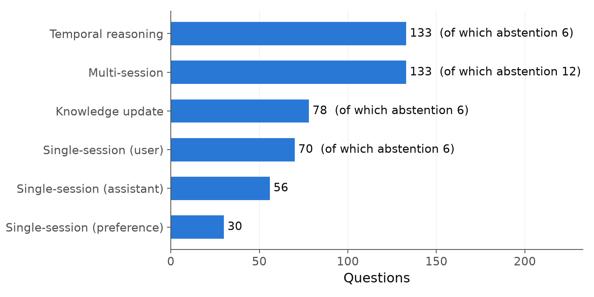
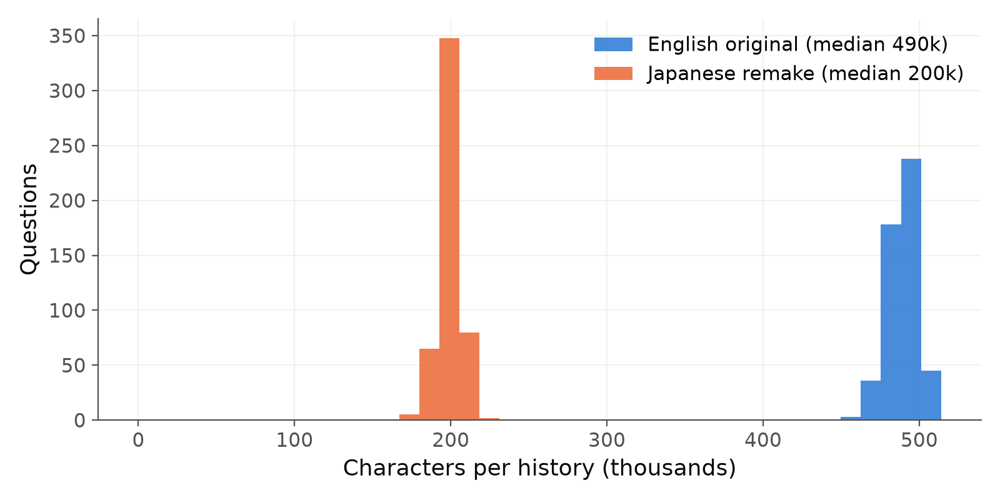
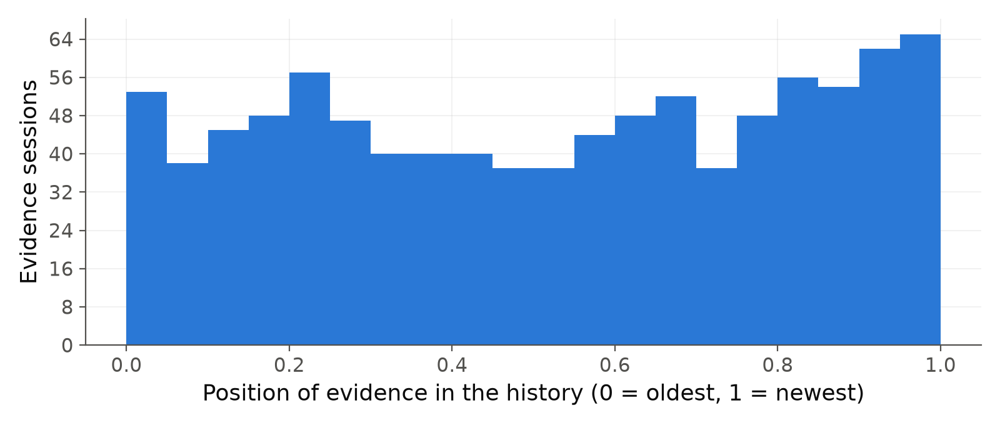
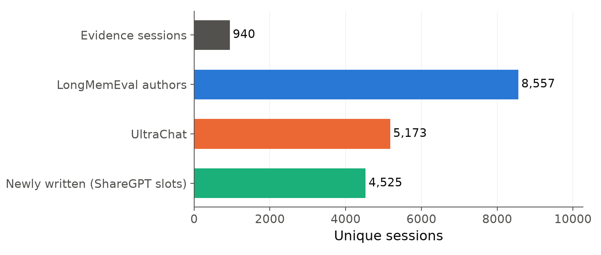
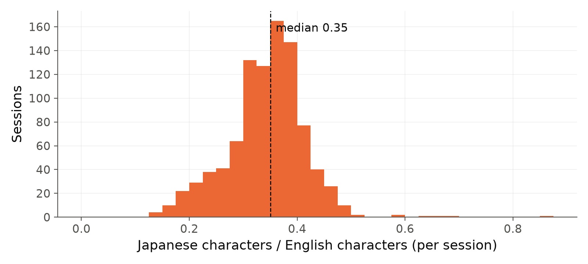
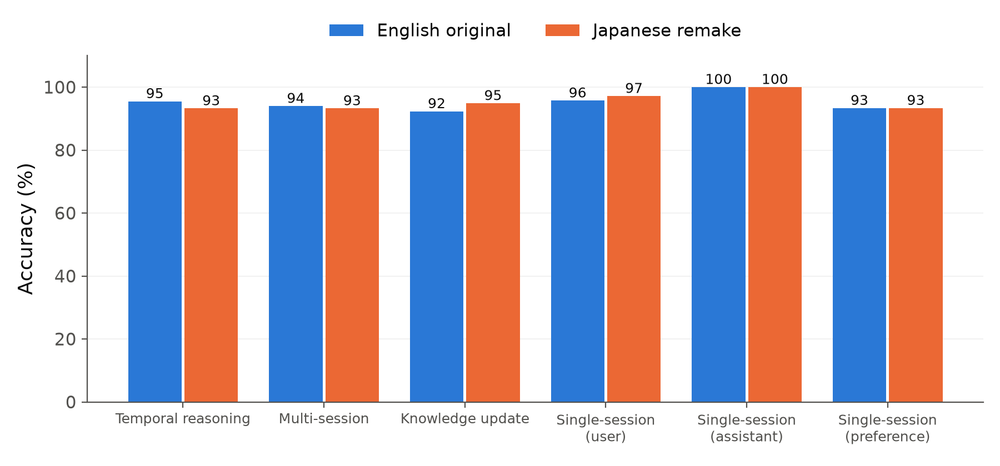

<p align="center">
  
</p>

<p align="center"><strong>An unofficial Japanese remake of LongMemEval, adapted to everyday life in Japan</strong></p>

<p align="center">
  <a href="https://huggingface.co/datasets/hisashi-ito/longmemeval-ja"></a>
  <a href="./LICENSE"></a>
  <a href="https://arxiv.org/abs/2410.10813"></a>
  
</p>

<p align="center"><strong>English</strong> | <a href="./README_ja.md">日本語</a></p>

A Japanese remake of [LongMemEval](https://github.com/xiaowu0162/LongMemEval) (Wu et al., ICLR 2025), a benchmark for the long-term memory of chat assistants, adapted to everyday life in Japan. This is not an official release by the LongMemEval authors.

This repository holds the scripts that build the dataset, the instructions given to the models, and the verification procedure. The dataset itself is published on Hugging Face.

## Terms

| Term | Meaning |
|---|---|
| Evidence session | A session that contains the answer to the question. Each question has one to several |
| Unrelated session | A session unrelated to the question, mixed in to bury the evidence in the history |
| Abstention question | A question that tests whether the assistant notices the history has no answer and declines to answer |
| Oracle version | The version whose history for each question consists of evidence sessions only |
| S version | The version that mixes the evidence sessions into unrelated sessions; each history has about 48 sessions. S stands for small; the original LongMemEval also has an M (medium) version with about 500 sessions, which is not remade here |

## Why a remake, not a translation

LongMemEval's conversations assume life in the United States: dollars, miles, gallons, US stores, mortgages in the hundreds of thousands of dollars. A literal translation keeps conversations that people in Japan do not have.

So we kept the benchmark's skeleton and rewrote the content for life in Japan. The skeleton is the question types, the evidence sessions, the abstention questions, the dates, and the position of the evidence in the history. The rewriting rules are:

- Yen instead of dollars, with amounts that are natural in Japan, not a mechanical exchange rate
- Metric units for length and weight
- Japanese stores, places, holidays, food and institutions
- Books, films, music and games are kept as they are, because people in Japan read and watch foreign works too
- Session dates, question dates and the order of events are unchanged
- Every answer must still follow from the rewritten sessions; when a number used in a calculation changes, the calculation and the answer are redone

## Versions

| Version | History per question | Corresponding original |
|---|---|---|
| `longmemeval_ja_oracle` | Evidence sessions only | `longmemeval_oracle` |
| `longmemeval_ja_s` | Evidence sessions mixed into about 48 unrelated sessions | `longmemeval_s_cleaned` |

The original task also measures finding the evidence in a long history. The oracle version does not include that part, so do not report oracle scores as LongMemEval scores.

## What is in it, and where it comes from

| Part | Source | License of the source | How it was made |
|---|---|---|---|
| 500 questions and answers, 940 evidence sessions | Written by the LongMemEval authors | MIT | Rewritten for life in Japan |
| 8,557 unrelated sessions written by the authors | LongMemEval | MIT | Rewritten for life in Japan |
| 5,173 unrelated sessions from UltraChat | UltraChat | MIT | Rewritten for life in Japan |
| 4,525 unrelated sessions in the positions of ShareGPT conversations | None | — | Newly written in Japanese |

ShareGPT conversations are real users' conversations shared from ChatGPT, collected and redistributed without the writers' own permission. We therefore neither translate nor include them. Their positions hold new conversations written in Japanese.

The new conversations were made like this. To keep the variety of real requests, a model first read each ShareGPT conversation and wrote out only a one-line, generalized topic and a request type. It was not allowed to write out names, numbers or specific circumstances. The new conversation was then written from that line alone. No ShareGPT text appears in the dataset.

Every new conversation was screened by a model for harmful content. Some were flagged because the topic still carried the content of the original ShareGPT request, such as sexual content about a real person or a text arguing for forged IDs. These, together with the positions for which no topic could be extracted, 20 in all, were rewritten from benign topics taken from other positions and screened again. Each of the 20 uses a different topic.

## What the data looks like

### Question types

The 500 questions follow the original LongMemEval breakdown.



### History length and evidence position in the S version

Each question in the S version has a history of about 48 sessions. The median is 518 turns and about 200k Japanese characters per question; the English original has a median of about 490k characters. Evidence sessions are spread from the oldest to the newest part of the history.





### Where the sessions come from



### Japanese-to-English length ratio

Dividing the Japanese character count of each session by its English character count gives a median of 0.35. Japanese needs fewer characters than English, and long replies in the original were shortened to a length that is natural for everyday conversation in Japan. The shortening kept the evidence and the numbers needed for the answers; the shape check and the answer verification confirm this.



### Answer verification

Claude Opus 5.5 read only the rewritten sessions and the question and answered, and Claude Haiku 5.5 judged whether the answer matched the gold answer. The English original was solved the same way, and questions where Japanese and English disagreed were re-judged by Claude Fable 5.2. On the oracle version, the Japanese remake gets 474 of 500 correct and the English original 475.



Twenty questions were solved in English but not in Japanese. We read each of them: fourteen had been broken by the rewrite, with yen totals that no longer added up, dropped facts, or an answer leaking into an abstention question. These fourteen were repaired and verified again. No problem in the data was found for the other six.

## Pipeline

All generation runs through the Claude Message Batches API. The instructions are in `src/lmeja/*.md`.

| Step | Command | Model |
|---|---|---|
| Rewrite questions, answers and evidence sessions | `trial-submit`, `full-submit`, `redo-submit`, `retry` | Claude Sonnet 5.5 |
| Repair broken questions | `repair`, `repair-sonnet` | Claude Opus 5.5, Claude Sonnet 5.5 |
| Rewrite unrelated sessions | `filler-full`, `filler-retry`, `filler-retry2` | Claude Haiku 5.5; retries with Claude Sonnet 5.5 |
| Extract topics from ShareGPT positions and write new sessions | `scratch-full`, `scratch-retry` | Claude Haiku 5.5 |
| Screen new sessions for harmful content and replace topics | `safety`, `replace-unsafe` | Claude Haiku 5.5 |
| Redo sessions that kept English | `fix-english` | Claude Sonnet 5.5 |
| Compare shape with the original and check the format | Runs every time results are fetched | None; rule-based |
| Solve without seeing the answer, then judge against the gold answer | `verify-full`, `rejudge` | Claude Opus 5.5 solves; Claude Haiku 5.5 and Claude Fable 5.2 judge |

Run `uv run python -m lmeja` for the list of commands. The API key is passed through the `ANTHROPIC_API_KEY` environment variable, or through a `.env` file whose path is given in `LMEJA_KEY_FILE`. The source data is downloaded from the original Hugging Face dataset into `data/raw/` and is not committed.

## Checks

| Check | What was checked | Result |
|---|---|---|
| Shape | Number and order of sessions and turns, roles, positions of `has_answer`, all dates | Identical to the original. `has_answer` is a marker, not content, so when only its position differed it was restored from the original |
| Format | Fields and types, empty turns, turns left in English, rewrite traces, truncated turns | Sessions that kept English were redone. The only English left is in three English-practice conversations, where the user's English is meant to be there |
| Answer | See "Answer verification" above | 474 correct in Japanese, 475 in the English original |
| Leakage | For questions with short answers, whether the answer string appears in an unrelated session | 49 of 313 questions (16%), against 68 of 244 (28%) in the English original. The matches are mostly common quantities such as "2 hours" and store names; the original has the same kind of overlap |
| Harmful content | All 4,525 newly written sessions | See "What is in it, and where it comes from" above |

Three things are kept as in the original:

- 13 questions whose history lists the same session id twice in the original keep it
- Sessions that are cut off in the original are cut off at the same place in Japanese
- `answer` is a string everywhere, although some answers are numbers in the original

## Notes on use

- Do not report scores on the oracle version as LongMemEval scores; the reason is in "Versions"
- Do not compare Japanese scores directly with scores on the English original; the content and length of the sessions differ
- The new sessions do not have the same number of turns as the ShareGPT sessions they replace

## License and attribution

The scripts and the dataset in this repository are released under the MIT License ([`LICENSE`](LICENSE)). Most of the dataset is a rewrite of LongMemEval and UltraChat, which are also released under the MIT License. Their notices are kept in [`LICENSE.upstream`](LICENSE.upstream) and [`NOTICE.md`](NOTICE.md). If you use this dataset, please also cite the original works:

```bibtex
@inproceedings{wu2025longmemeval,
  title     = {LongMemEval: Benchmarking Chat Assistants on Long-Term Interactive Memory},
  author    = {Di Wu and Hongwei Wang and Wenhao Yu and Yuwei Zhang and Kai-Wei Chang and Dong Yu},
  booktitle = {International Conference on Learning Representations (ICLR)},
  year      = {2025},
  note      = {arXiv:2410.10813}
}

@article{ding2023ultrachat,
  title   = {Enhancing Chat Language Models by Scaling High-quality Instructional Conversations},
  author  = {Ning Ding and Yulin Chen and Bokai Xu and Yujia Qin and Zhi Zheng and Shengding Hu and
             Zhiyuan Liu and Maosong Sun and Bowen Zhou},
  journal = {arXiv preprint arXiv:2305.14233},
  year    = {2023}
}
```
