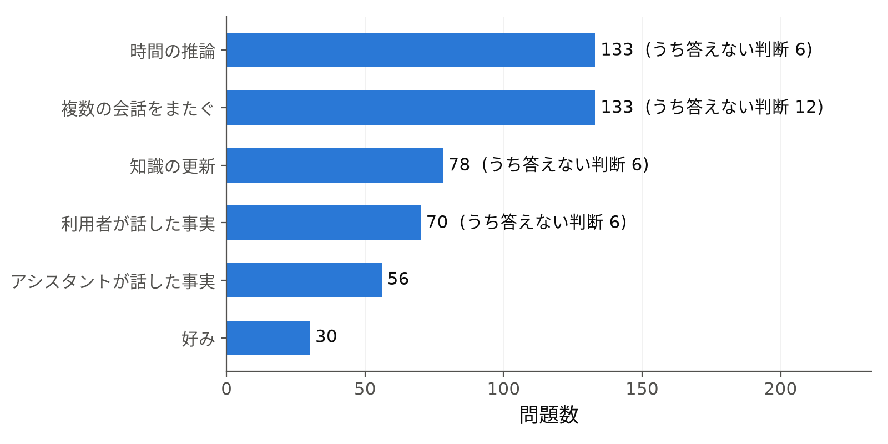
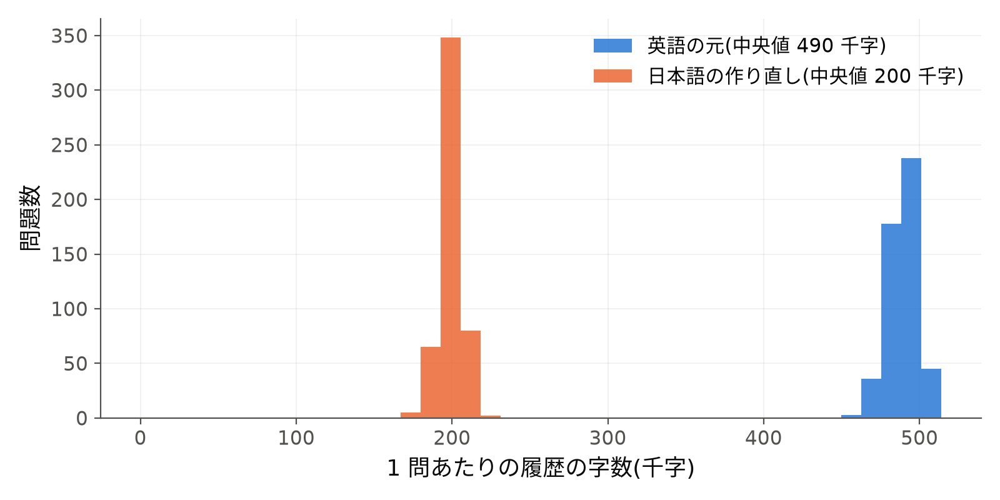
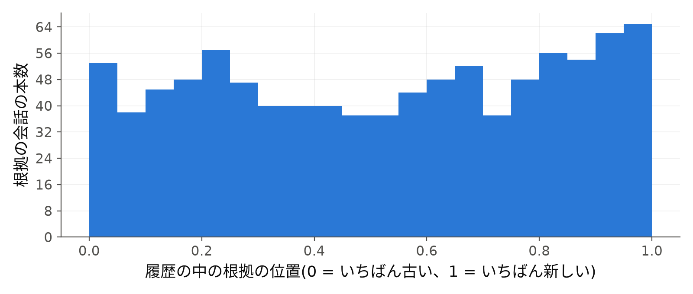
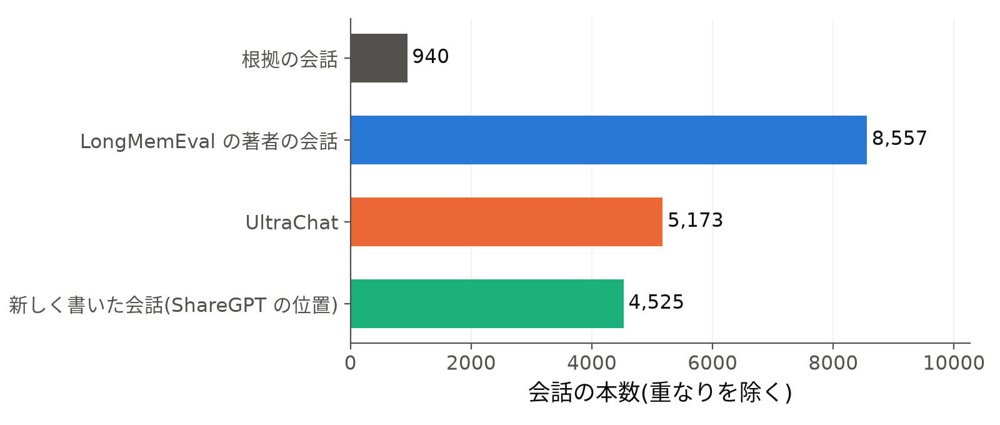
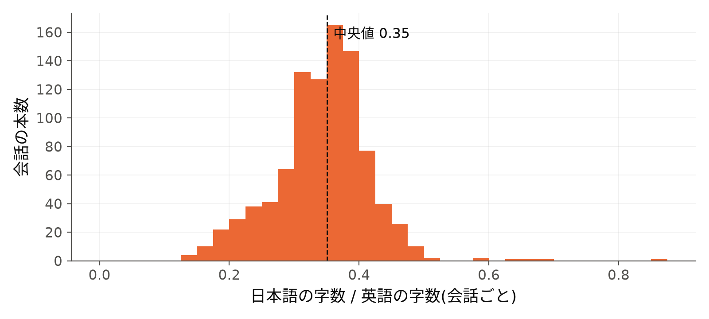
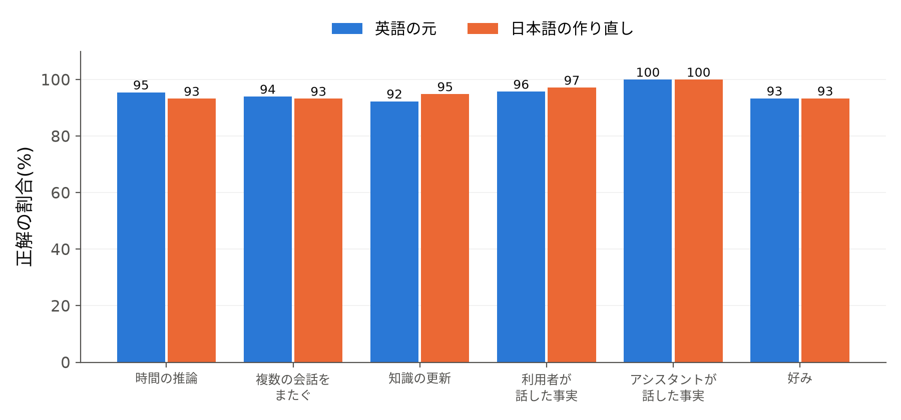

  

<strong>LongMemEval を日本の暮らしに合わせて作り直した、非公式の日本語版</strong>

  
  
  
  

<a href="./README.md">English</a> | <strong>日本語</strong>

チャットアシスタントの長期記憶を測るベンチマーク [LongMemEval](https://github.com/xiaowu0162/LongMemEval) (Wu et al., ICLR 2025)を、日本の暮らしに合わせて日本語で作り直しました。LongMemEval の著者による公式の版ではありません。

このリポジトリには、データを作るスクリプト、モデルへの指示文、検証の手順を置いています。データ本体は Hugging Face で公開します。

## 用語

| 用語 | 意味 |
|---|---|
| 根拠の会話 | 質問の答えが含まれている会話。1 問に 1 本から数本ある |
| 関係ない会話 | 質問と関係のない会話。根拠の会話を履歴の中に埋もれさせるために混ぜる |
| 答えない判断 | 履歴に答えが無いことに気づき、答えを控えられるかを見る問題 |
| oracle 版 | 1 問の履歴が根拠の会話だけでできている版 |
| S 版 | 根拠の会話を、関係ない会話に混ぜた版。1 問の履歴は約 48 本の会話になる。S は small の意味で、元の LongMemEval には約 500 本の M(medium)版もある。M 版は作り直していない |

## 訳さずに作り直した理由

LongMemEval の会話は、米国の暮らしを前提にしています。ドル、マイル、ガロン、米国の店、数十万ドルの住宅ローンといった具合です。そのまま訳すと、日本で暮らす人がしない会話が残ります。

そこで、ベンチマークの骨組みは保ったまま、中身を日本の暮らしに書き直しました。保った骨組みは、問題の種類、根拠の会話、答えない判断の問題、日付、履歴の中での根拠の位置です。書き直しの決まりは次のとおりです。

- お金はドルから円にし、日本の相場で自然な額にする。為替で機械的に換算はしない
- 長さや重さは、メートル法にする
- 店、地名、祝日、食べ物、制度は、日本のものにする
- 本、映画、音楽、ゲームなどの作品は置き換えない。日本の利用者も海外の作品を読み、観るため
- 会話の日付、質問の日付、出来事の前後関係は変えない
- 作り直した会話から答えが導けるようにする。計算に使う数を変えたときは、計算し直して答えも直す

## 版

| 版 | 1 問あたりの履歴 | 対応する元の版 |
|---|---|---|
| `longmemeval_ja_oracle` | 根拠の会話だけ | `longmemeval_oracle` |
| `longmemeval_ja_s` | 根拠の会話を、約 48 本の関係ない会話に混ぜたもの | `longmemeval_s_cleaned` |

元の課題は、長い履歴の中から根拠を探す力も測っています。oracle 版にはその部分が無いので、oracle 版の点数を LongMemEval の点数として報告しないでください。

## 中身と出どころ

| 部分 | 出どころ | 出どころのライセンス | 作り方 |
|---|---|---|---|
| 500 問の質問と答え、根拠の会話 940 本 | LongMemEval の著者が作ったもの | MIT | 日本の暮らしに作り直した |
| 著者が作った関係ない会話 8,557 本 | LongMemEval | MIT | 日本の暮らしに作り直した |
| UltraChat の関係ない会話 5,173 本 | UltraChat | MIT | 日本の暮らしに作り直した |
| ShareGPT の会話が入っていた位置の、関係ない会話 4,525 本 | 無し | — | 日本語で新しく書いた |

ShareGPT の会話は、実在の利用者が ChatGPT から共有した会話を、書いた本人の許諾なしに集めて配ったものです。そのため訳さず、データにも入れていません。その位置には、日本語で新しく書いた会話を入れました。

新しい会話の書き方はこうです。実際の利用者の頼みごとの幅を保ちたいので、まずモデルに ShareGPT の会話を読ませ、一般化した 1 行の話題と、頼み方の種類だけを書き出させました。名前、数字、固有の状況は書き出させていません。新しい会話は、その 1 行だけを見て書かせています。ShareGPT の文は、データに 1 文も入っていません。

新しく書いた会話は、すべてモデルで有害な中身がないかを判定しました。元の ShareGPT の依頼の中身が話題に残っていて、有害と判定されたものがありました。実在の人物を性的に扱う依頼や、偽造の身分証明書を正当化する原稿などです。これらと、話題を取り出せなかった位置、合わせて 20 本は、ほかの位置の無害な話題に替えて書き直し、もう一度判定に通しました。入れ替えに使った話題は、20 本ですべて違います。

## データの中身

### 問題の種類

500 問の内訳は、元の LongMemEval と同じです。

### S 版の履歴の長さと、根拠の位置

S 版の 1 問の履歴は、約 48 本の会話でできています。発言の数は中央値で 518 個、日本語の字数は中央値で約 20 万字です。英語の元の版は、同じ中央値で約 49 万字あります。根拠の会話は、履歴の古いほうから新しいほうまで散らばっています。

### 会話の出どころ

### 英語と日本語の字数の比

会話ごとに日本語の字数を英語の字数で割ると、中央値は 0.35 です。日本語が英語より少ない字数で書けることに加えて、英語の元の長い返事を、日本の暮らしの会話として自然な長さに縮めたためです。縮めても、根拠の文と答えに要る数は落としていません。このことは、構造の検査と答えの検証で確かめています。

### 答えの検証

作り直した会話と質問だけを Claude Opus 5.5 に読ませて答えさせ、その答えが正解と合っているかを Claude Haiku 5.5 に判定させました。英語の元の版も同じ方法で解かせ、日本語と英語で結果が割れた問題は、Claude Fable 5.2 で判定し直しています。oracle 版で解かせたところ、正解は日本語の作り直しが 500 問中 474 問、英語の元の版が 475 問でした。

英語の元の版では解けて、日本語では解けなかった問題が 20 問ありました。1 問ずつ中身を読んだところ、14 問は作り直しで壊れていました。円に直した金額の合計が合わない、事実が抜けている、答えない判断の問題で答えが会話に漏れている、といった壊れ方です。この 14 問は直して、もう一度検証しました。残りの 6 問では、データに壊れたところは見つかりませんでした。

## 作り方

生成はすべて、Claude の Message Batches API で行いました。指示文は `src/lmeja/*.md` にあります。

| 段 | コマンド | モデル |
|---|---|---|
| 質問、答え、根拠の会話を作り直す | `trial-submit`、`full-submit`、`redo-submit`、`retry` | Claude Sonnet 5.5 |
| 壊れた問題を直す | `repair`、`repair-sonnet` | Claude Opus 5.5、Claude Sonnet 5.5 |
| 関係ない会話を作り直す | `filler-full`、`filler-retry`、`filler-retry2` | Claude Haiku 5.5。やり直しは Claude Sonnet 5.5 |
| ShareGPT の位置の話題を取り出し、新しい会話を書く | `scratch-full`、`scratch-retry` | Claude Haiku 5.5 |
| 新しい会話の有害な中身を判定し、話題を入れ替える | `safety`、`replace-unsafe` | Claude Haiku 5.5 |
| 英語が残った会話を作り直す | `fix-english` | Claude Sonnet 5.5 |
| 元の版と構造を突き合わせ、形式を検査する | 結果を取り込むたびに実行 | 使わない。規則で判定する |
| 答えを見せずに解かせ、正解と合うかを判定する | `verify-full`、`rejudge` | 解くのは Claude Opus 5.5、判定は Claude Haiku 5.5 と Claude Fable 5.2 |

コマンドの一覧は `uv run python -m lmeja` で出ます。API の鍵は、環境変数 `ANTHROPIC_API_KEY` で渡すか、鍵を書いた `.env` のパスを `LMEJA_KEY_FILE` で渡します。元のデータは、元の Hugging Face のデータセットから `data/raw/` にダウンロードして使います。リポジトリには入れていません。

## 検査

| 検査 | 見たもの | 結果 |
|---|---|---|
| 構造 | 会話と発言の数と順番、話し手、`has_answer` の位置、すべての日付 | 元の版と同じ。`has_answer` は中身ではなく目印なので、位置だけがずれたときは元の位置に戻した |
| 形式 | 項目と型、空の発言、英語のまま残った発言、作り直しの跡の言葉、途中で切れた発言 | 英語が残った会話は作り直した。いま英語が残っているのは、英語の練習の会話 3 本だけで、利用者の英文が残るのが正しい形である |
| 答え | 上の「答えの検証」 | 日本語 474 問、英語の元の版 475 問が正解 |
| 漏れ | 答えが短い問題で、答えの文字列が関係ない会話に出てくるか | 出てくる問題は 313 問中 49 問で 16%。英語の元の版は 244 問中 68 問で 28%。出てくるのは「2時間」のようなありふれた量と店の名前がほとんどで、元の版にも同じ種類の重なりがある |
| 有害な中身 | 新しく書いた会話 4,525 本 | 上の「中身と出どころ」のとおり |

次の 3 点は、元の版にそろえてあります。

- 元の版で、1 問の履歴に同じ会話の番号が 2 度出てくる問題が 13 問あります。そのまま残しています
- 元の版で途中で切れている会話は、日本語でも同じところで切れています
- 答え(`answer`)は、元の版では数値のものがありますが、すべて文字列にそろえました

## 使うときの注意

- oracle 版の点数を、LongMemEval の点数として報告しないでください。理由は「版」の節に書きました
- 日本語版の点数を、英語の元の版の点数とそのまま比べないでください。会話の中身も長さも違います
- 新しく書いた会話は、置き換えた ShareGPT の会話と、発言の数がそろっていません

## ライセンスと出典

このリポジトリのスクリプトとデータは、MIT ライセンスで公開します([`LICENSE`](LICENSE))。データの大部分は、 LongMemEval と UltraChat を作り直したものです。この 2 つも MIT ライセンスです。その表示は [`LICENSE.upstream`](LICENSE.upstream) と [`NOTICE.md`](NOTICE.md) にあります。このデータを使うときは、元の論文も引用してください。BibTeX は [README.md](README.md) にあります。

- Di Wu, Hongwei Wang, Wenhao Yu, Yuwei Zhang, Kai-Wei Chang, Dong Yu. LongMemEval: Benchmarking Chat Assistants on Long-Term Interactive Memory. ICLR 2025. arXiv:2410.10813
- Ning Ding, Yulin Chen, Bokai Xu, Yujia Qin, Zhi Zheng, Shengding Hu, Zhiyuan Liu, Maosong Sun, Bowen Zhou. Enhancing Chat Language Models by Scaling High-quality Instructional Conversations. arXiv:2305.14233, 2023
